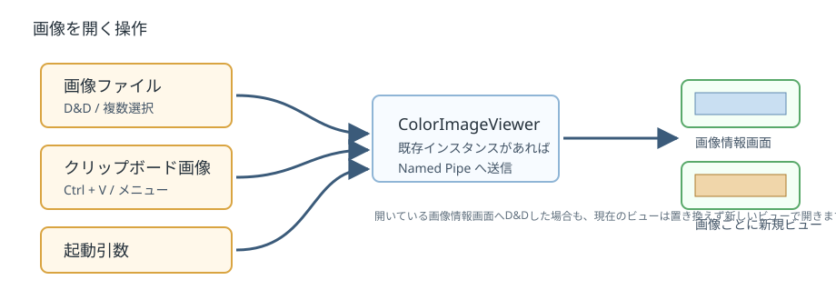
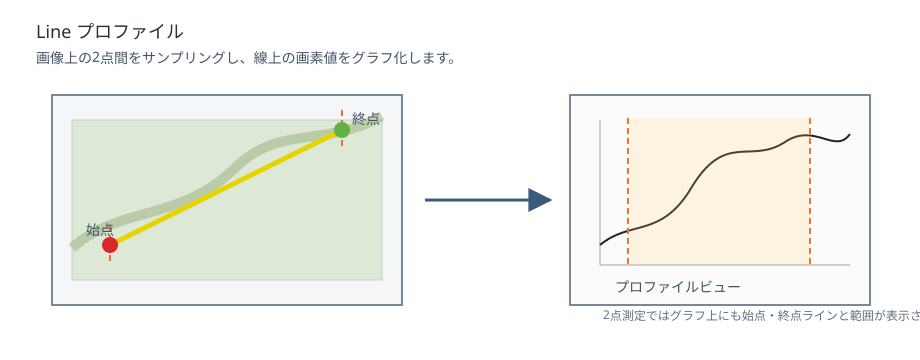
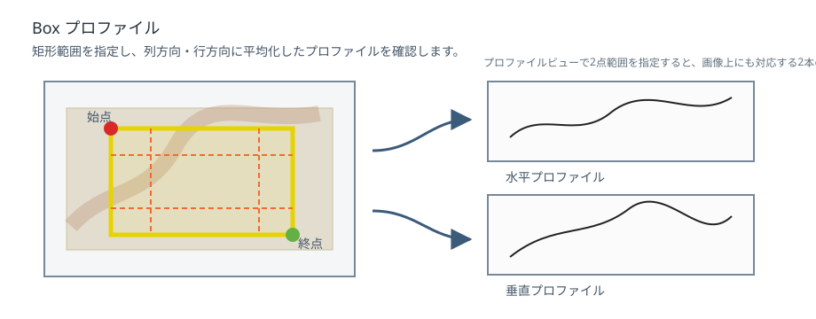
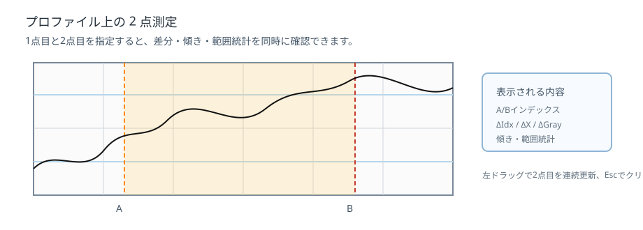
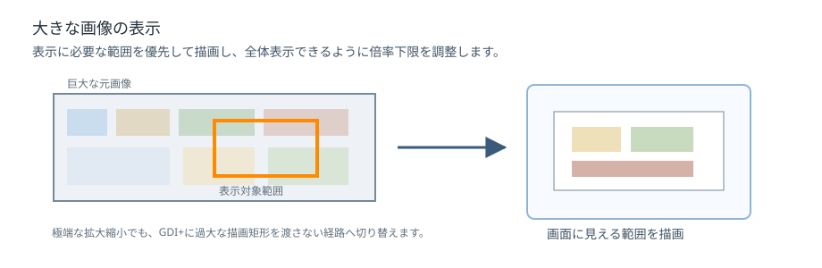

# ColorImageViewer 取扱説明書

最終更新: 2026-09-28

## 1. 概要

ColorImageViewer は、画像を表示し、拡大縮小、色値確認、プロファイル解析、画像保存、クリップボード連携を行うための画像ビューアです。

主な用途は次のとおりです。

- 画像の拡大・縮小表示
- マウス位置の RGB、輝度、HSV、YCrCb 値の確認
- Line / Box 指定によるプロファイル表示
- プロファイルの統計表示と 2 点測定
- プロファイルのピント指標表示
- プロファイル範囲の平均色画像表示
- 表示画像・元画像・プロファイル画像の保存またはクリップボードコピー
- 複数画像を個別ビューで表示
- 同じ画像サイズのビュー間で表示位置・倍率を同期
- 表示枠付き画像の表示・保存
- 読み込み・描画などの処理時間の確認

## 2. 画面構成

### 2.1 メインフォーム

起動直後に表示される画面です。

画面内に画像ファイルをドラッグアンドドロップすると、画像情報画面を開きます。

既にアプリケーションが起動している場合、追加起動されたファイル指定は既存インスタンスへ送られます。

### 2.2 画像情報画面

画像を表示・解析する中心画面です。

主な表示情報は次のとおりです。

- 表示倍率
- 画像サイズ
- マウスカーソル位置
- RGB 値
- 輝度値
- HSV 値
- YCrCb 値
- 平均色
- プロファイル情報

### 2.3 プロファイルビュー

Line / Box 指定時に表示されるグラフ画面です。

プロファイルビューでは、RGB、輝度、H、S の表示切り替え、グリッド表示、統計表示、ピント指標表示、2 点測定を行えます。

プロファイルビューの前面表示は、設定画面またはプロファイルビューの右クリックメニューから変更できます。

- ParentForeground: 画像情報画面の前面に表示します。
- AlwaysTopMost: 常に最前面に表示します。
- Normal: 通常のウィンドウとして表示します。

## 3. 画像を開く

### 3.1 メインフォームへドラッグアンドドロップ

メインフォームの「ここに画像イメージをドラッグアンドドロップして下さい」と表示されている領域へ画像ファイルをドロップします。

複数ファイルをドロップした場合、各画像は個別の画像情報画面で開きます。

主に対応する画像形式は PNG、JPEG、JFIF、BMP、GIF、TIFF です。

WebP、AVIF、HEIC、HEIF は拡張子では除外せず読み込みを試みますが、実際に開けるかどうかは実行環境の画像コーデックに依存します。

### 3.2 開いている画像情報画面へドラッグアンドドロップ

既に開いている画像情報画面へ画像ファイルをドロップすると、現在のビューを置き換えず、新しい画像情報画面で開きます。

### 3.3 クリップボード画像を開く

クリップボードに画像がある場合、新しい画像情報画面として開けます。

利用できる操作は次のとおりです。

- メインフォームで `Ctrl + V`
- 画像情報画面のコンテキストメニュー「クリップボード画像を新しいビューで開く」
- コマンドライン引数 `--clipboard`、`/clipboard`、`-clipboard`、`--paste`、`/paste`、`-paste`

### 3.4 コマンドラインまたはファイル関連付けから開く

画像ファイルパスを起動引数として指定すると、その画像を開きます。

既に ColorImageViewer が起動している場合は、Named Pipe により既存インスタンスへ画像オープン要求を送ります。

### 3.5 読み込み完了時の前面表示

ファイルの読み込みと進捗画面の終了後、最後に開いた画像情報画面を前面に表示します。既存インスタンスへファイルを渡す場合も、前面表示の権限を引き継ぐ処理を行います。常に最前面へ固定する機能ではなく、Windows の前面表示制限によって手前に出ない場合もあります。

## 4. 画像表示操作

### 4.1 拡大・縮小

画像上でマウスホイールを操作すると、画像を拡大・縮小します。

`Shift` キーを押しながら操作すると、通常より細かい倍率変更になります。

ショートカットでも操作できます。

| 操作 | 内容 |
| --- | --- |
| `Ctrl + +` | 拡大 |
| `Ctrl + -` | 縮小 |
| `Ctrl + Shift + +` | 細かく拡大 |
| `Ctrl + Shift + -` | 細かく縮小 |

### 4.2 表示位置の移動

画像上で左ドラッグすると表示位置を移動できます。

`Ctrl` キー押下中は、プロファイル指定操作などに使用されるため、通常の移動操作は抑制されます。

### 4.3 フィット表示

画像をダブルクリックすると、画像が画面にフィットします。

コンテキストメニューからも操作できます。

- 「フィット（ダブルクリック）」
- 「等倍(100%)」
- 「指定倍率」

### 4.4 表示サイズ指定

画像情報画面の表示領域サイズを数値指定できます。

コンテキストメニュー「表示サイズ指定」から実行します。

### 4.5 Fix モード

`Fix` を有効にすると、表示倍率や表示位置の自動調整を抑制します。

同じ表示条件を維持したまま確認したい場合に使用します。

### 4.6 表示枠を別ウィンドウで確認する

画像上の右クリックメニュー「表示枠情報を別の画像情報画面に表示」を選ぶと、元画像の複製に現在の表示範囲を赤枠で示した画像情報画面を開きます。

赤枠は、元画像のサイズやそのウィンドウの表示倍率によらず、画面上で 3 ピクセル幅で描画します。枠の位置は作成時点の表示範囲を保持し、元のウィンドウを後から移動・拡大しても追従しません。

枠は表示用に重ねて描くため、元画像の画素値は変更しません。保存時の枠線の有無は「6.3 表示枠ウィンドウの保存」で選びます。

## 5. 色情報の確認

画像上でマウスを移動すると、カーソル位置に対応する情報が画面上に表示されます。

表示される主な情報は次のとおりです。

- 画像座標
- サブピクセル座標
- RGB
- 輝度
- HSV
- YCrCb

画像外にカーソルがある場合、座標や色値は無効値として表示されます。

## 6. 画像の保存・コピー

画像情報画面のコンテキストメニューから、表示画像または元画像を保存・コピーできます。

### 6.1 表示画像

表示中の領域を対象にします。

- 「表示画像をファイルに保存」
- 「表示画像をクリップボードにコピー」
- 「表示画像を画像情報画面で表示」

### 6.2 元画像

読み込んだ元画像全体を対象にします。

- 「元画像をファイルに保存」
- 「元画像をクリップボードにコピー」
- 「元画像を画像情報画面で表示」

ショートカット:

| 操作 | 内容 |
| --- | --- |
| `Ctrl + S` | 通常は元画像を保存。表示枠ウィンドウでは保存方法を選択（6.3） |
| `Ctrl + C` | 元画像をクリップボードにコピー |
| `Ctrl + V` | 元画像を画像情報画面で表示 |

### 6.3 表示枠ウィンドウの保存

「表示枠情報を別の画像情報画面に表示」で開いたウィンドウでは、保存メニューが次のように変わります。

| メニュー | 保存範囲・サイズ | 枠線 |
| --- | --- | --- |
| 表示範囲を保存（枠線あり） | 現在見えている範囲を表示サイズで保存。画面上の余白や測定用の線も含む | 画面内に見えている部分を含む |
| 画像全体を保存（枠線あり） | 画像全体を元のピクセル寸法で保存 | 赤い表示枠を画像に描き込む |
| 元画像を保存（枠線なし） | 画像全体を元のピクセル寸法で保存 | 含まない |

`Ctrl + S` を押すと「保存方法を選択」画面が開きます。初期選択は「画像全体を保存（枠線あり・元の解像度）」です。保存方法を選び、「次へ」から保存先・ファイル名を指定します。キャンセルすると保存しません。

画像全体の枠付き保存では、線幅を「3 ÷ 現在の表示倍率」画像ピクセルに換算します。同じ倍率で開くとおおむね現在と同じ太さになりますが、保存後の枠線は画素の一部になるため、再び拡大・縮小すると太さも変わります。画像外の枠線は保存されません。既定のファイル名には `_枠線あり` が付きます。

画像全体の枠付き保存は、保存用に画像を複製するため、大きな画像では追加のメモリが必要です。表示中の元画像データは変更しません。

クリップボードコピーは従来どおり、表示画像のコピーには画面に見えている枠線が含まれ、元画像のコピーには含まれません。元画像を別の画像情報画面で開く操作も、枠線なしの画像を対象にします。

## 7. 表示情報のコピー・復元

現在の表示位置、倍率、表示サイズ、オプション情報をクリップボードへコピーし、後から復元できます。

| 操作 | 内容 |
| --- | --- |
| `Ctrl + Shift + C` | 表示情報をクリップボードへコピー |
| `Ctrl + Shift + V` | クリップボードの表示情報をインポート |
| `Ctrl + Shift + Alt + V` | 表示情報をインポートし、ウィンドウ位置も反映 |

同じ画像や類似画像を同じ表示条件で確認する場合に使用します。

### 7.1 表示位置・倍率を継続して同期する

画像の幅と高さがそれぞれ同じビュー同士で、表示位置と倍率を連動できます。

1. 基準にする画像で `Ctrl + Shift + C` を押します。
2. 別の画像上で右クリックし、「コピー元の画像と表示を同期」を選びます。
3. コピー元の現在の表示位置・倍率が反映され、両方のタイトルに `[同期中]` が付きます。
4. どちらかの画像を拡大・縮小・移動すると、同じグループの画像へ反映されます。

同じ画像座標を表示領域の同じ位置に合わせます。ウィンドウサイズが違う場合、見える範囲の広さは異なります。ウィンドウ自体の位置・サイズや、プロファイルの測定範囲は同期しません。

3 枚以上を同期する場合は、参加済みの画像で表示情報をコピーし、追加する画像で同じメニューを選びます。別グループに参加している画像を追加した場合、その画像だけが新しいグループへ移ります。

コピー元の画像が閉じている場合や画像サイズが異なる場合は、理由を表示して同期を開始しません。クリップボードを別の内容で上書きした場合は、基準画像で再度 `Ctrl + Shift + C` を押してください。同期開始後はクリップボードの内容を変えても同期は続きます。

`Ctrl + Shift + V` は従来どおり一度だけ表示情報を反映する操作で、同期の開始・解除は行いません。ただし同期中のビューへ貼り付けて位置・倍率が変わると、その変更も同期先に反映されます。

### 7.2 同期を解除する

同期から外したい画像を右クリックし、「表示の同期を解除」を選びます。その画像だけが同期から外れ、タイトルの `[同期中]` が消えます。現在の表示位置・倍率は保持します。

ウィンドウを閉じた場合も、その画像は同期から外れます。残りが 2 枚以上なら同期を続け、最後の 1 枚になった場合は自動解除します。Fix モードは同期解除の代わりにはならず、同期先からの位置・倍率変更は反映されます。

## 8. ウィンドウ操作

| 操作 | 内容 |
| --- | --- |
| `Ctrl + Alt + ↑` | ウィンドウを上へ 1 ピクセル移動 |
| `Ctrl + Alt + ↓` | ウィンドウを下へ 1 ピクセル移動 |
| `Ctrl + Alt + ←` | ウィンドウを左へ 1 ピクセル移動 |
| `Ctrl + Alt + →` | ウィンドウを右へ 1 ピクセル移動 |
| `Ctrl + T` | タイトル変更モード |
| `Esc` | タイトル変更モードを解除 |

## 9. プロファイル解析

画像情報画面の `ProfileMode` で、Line または Box を選択します。

### 9.1 Line プロファイル

Line モードでは、指定した 2 点間の画素値をプロファイルとして表示します。

操作手順:

1. `ProfileMode` で `Line` を選択します。
2. `Ctrl` キーを押しながら画像上で開始点をクリックします。
3. `Ctrl` キーを押しながら終了点をクリックします。
4. ラインプロファイルビューが表示されます。

プロファイルビュー上でマウス操作すると、画像上の対応位置がカーソル表示されます。

### 9.2 Box プロファイル

Box モードでは、矩形範囲を指定し、水平・垂直方向の平均プロファイルを表示します。

操作手順:

1. `ProfileMode` で `Box` を選択します。
2. `Ctrl` キーを押しながら画像上で矩形の開始点をクリックします。
3. `Ctrl` キーを押しながら矩形の終了点をクリックします。
4. 水平プロファイルビューと垂直プロファイルビューが表示されます。

Box 内の全画素に対する平均色も画像情報画面に表示されます。

### 9.3 プロファイル位置の移動

Line / Box の範囲指定後、`Ctrl` キーを押しながら既存の点または範囲付近をクリック・ドラッグすると、指定範囲を移動または再指定できます。

始点・終了点を指定済みの場合、画像情報画面またはプロファイルビューで `Ctrl + B` を押すと、指定範囲を保持したまま Line / Box を切り替えます。対角指定した範囲を Line から Box に切り替えたい場合に使用します。水平または垂直の指定では切り替えません。

### 9.4 数値入力

コンテキストメニュー「プロファイル（数値入力）」から、プロファイル範囲を数値で指定できます。

開始点と終了点が同じ X または Y の場合は Line、それ以外は Box として扱われます。

### 9.5 プロファイルビューの表示項目

プロファイルビューでは、以下の表示を切り替えられます。

- 輝度
- R
- G
- B
- H
- S
- グリッド
- グリッドH
- H-Base

`グリッド` が有効な場合は輝度系のY目盛、`グリッド` または `グリッドH` が有効な場合はプロファイル長さ方向のX目盛が表示されます。

### 9.6 統計表示・ピント指標

プロファイルビュー下部に、プロファイル全体の統計とピント指標が表示されます。

統計表示内容:

- データ数
- Gray の最小値
- Gray の最大値
- Gray の平均
- Gray の標準偏差
- RGB 平均値

ピント指標表示内容:

- 隣接輝度差二乗平均
- 隣接輝度差 RMS
- ラプラシアン二乗平均

### 9.7 プロファイル上の 2 点測定

プロファイルビュー上で 2 点を指定すると、2 点間の差分と範囲統計を表示します。

操作:

1. グラフ上で 1 点目を左クリックします。
2. グラフ上で 2 点目を左クリックします。
3. 2 点間の範囲がハイライト表示されます。

左ドラッグすると、終了点を連続的に更新できます。

表示内容:

- A / B のインデックス
- インデックス差分
- 距離差分
- Gray 値の差分
- 傾き
- 2 点間範囲の統計

`Esc` キーでプロファイルビュー上のカーソルと 2 点測定をクリアします。

### 9.8 プロファイルデータ出力

画像情報画面のプロファイル関連メニューから、データや画像を出力できます。

- 「CSVファイル出力」
- 「CSVクリップボード」
- 「トリミング」
- 「画像出力」
- 「平均色画像を表示」

「平均色画像を表示」は、プロファイル範囲の平均色で塗りつぶした画像を新しい画像情報画面で表示します。Line モードの場合、画像サイズは始点と終了点を対角とした矩形サイズになります。

プロファイルビューのコンテキストメニューから、グラフ画像やフォーム全体画像を保存・コピーできます。

### 9.9 プロファイル指定線の設定

画像情報画面の設定から、プロファイル指定時に画像上へ表示する範囲線、始点カーソル、終点カーソル、補助カーソルの色と線の太さを変更できます。

## 10. 余白削除・トリミング

### 10.1 余白削除

コンテキストメニュー「余白の削除」または `Alt + ダブルクリック` で、表示中画像に合わせて余白を調整します。

### 10.2 トリミング

Box モードで範囲指定している場合、コンテキストメニュー「トリミング」から矩形範囲を新しい画像情報画面で表示できます。

## 11. 大きな画像の扱い

巨大画像では、描画処理が自動的に巨大画像向けの表示経路へ切り替わります。

この経路では、画面に必要な範囲だけを描画し、GDI+ に過大な描画矩形を渡さないようにします。

また、画像サイズに応じて最小倍率が調整されるため、非常に大きな画像でも全体表示できるようにしています。

制限事項:

- メモリ不足が発生するほど大きな画像は開けない場合があります。
- 巨大画像の安全描画経路では、表示品質よりも安定性を優先するため、縮小表示がやや粗く見える場合があります。

## 12. 注意事項

- 画像読み込み中に追加読み込みを行うと、完了待ちのメッセージが表示されます。
- 読み込めないファイルが含まれる場合、読み込み結果メッセージに失敗内容が表示されます。
- 保存形式は、保存ダイアログの拡張子または選択されたファイル種類に従います。
- プロファイル機能は主に 24bit RGB 画像を対象とします。
- クリップボードに画像がない場合、クリップボード画像オープンは実行されません。

## 13. ショートカット一覧

| 操作 | 内容 |
| --- | --- |
| マウスホイール | 拡大・縮小 |
| `Shift + マウスホイール` | 細かく拡大・縮小 |
| 左ドラッグ | 表示位置の移動 |
| ダブルクリック | フィット表示 |
| `Alt + ダブルクリック` | 余白削除 |
| `Ctrl + +` | 拡大 |
| `Ctrl + -` | 縮小 |
| `Ctrl + Shift + +` | 細かく拡大 |
| `Ctrl + Shift + -` | 細かく縮小 |
| `Ctrl + S` | 通常は元画像を保存。表示枠ウィンドウでは保存方法を選択（6.3） |
| `Ctrl + C` | 元画像をクリップボードにコピー |
| `Ctrl + V` | 元画像を新しい画像情報画面で表示 |
| `Ctrl + Shift + C` | 表示情報をクリップボードへコピー |
| `Ctrl + Shift + V` | 表示情報をインポート |
| `Ctrl + Shift + Alt + V` | 表示情報をインポートし、ウィンドウ位置も反映 |
| `Ctrl + Alt + 矢印キー` | ウィンドウ位置を 1 ピクセル移動 |
| `Ctrl + T` | タイトル変更 |
| `Ctrl + B` | 指定済みプロファイル範囲を保持して Line / Box を切り替え（水平方向・垂直方向は対象外） |
| `Ctrl + Space` | 閉じたプロファイルビューを再表示 |
| `Esc` | 編集状態またはプロファイルビューのカーソルをクリア |

## 14. 処理時間の計測

画像上の右クリックメニュー「処理時間の計測...」で、今回の起動中に集計した処理時間を確認できます。全画像ウィンドウ共通で、単位はミリ秒（ms）です。

対象は、ファイルを開く全体、ファイル読み込み・デコード・画素形式変換、画像ウィンドウの作成・初回表示、画像の描画、矩形の平均色計算、水平・垂直プロファイル計算、表示同期です。実行された項目について、回数・最新・平均・最大・合計を表示します。

### 14.1 特定の操作を測定する

1. 「処理時間の計測...」を開き、「計測をリセット」を押します。
2. 計測画面を閉じます。
3. 測りたい操作（ドラッグ、連続ズーム、画像読み込みなど）を行います。
4. 再び計測画面を開き、平均・最大時間や回数を確認します。

「更新」は集計表示を読み直します。「計測をリセット」は全画像ウィンドウ共通の集計を消去します。記録はメモリ上だけに保存し、アプリ終了時に消えます。結果のテキストを選択してコピーすることもできます。

### 14.2 数値の読み方

- 項目には包含関係があります。たとえば初回表示には描画が、表示同期には同期先の描画が含まれるため、各項目の合計を足しても全体時間にはなりません。
- 複数ファイルをまとめて開いた場合、「ファイルを開く全体」は一括処理の時間です。
- 完了した計測区間を集計します。失敗・キャンセルした処理の区間も含みます。
- 描画時間はプログラム内の処理時間で、モニターに映るまでの時間や FPS ではありません。
- 比較時は、画像・表示サイズ・倍率・同期枚数・プロファイル表示条件をそろえてください。
